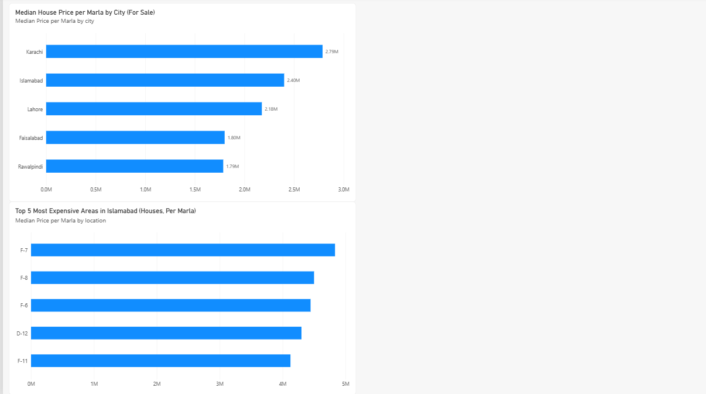

# Pakistan Real Estate Analytics

End-to-end analysis of about 190,000 property listings from Zameen.com, using PostgreSQL (Supabase), SQL and Power BI.

## What this project does

1. Loads raw listings into a `raw` schema (never modified).
2. Cleans the data in a separate view, `clean.property`.
3. Answers business questions with SQL.
4. Shows the results in a Power BI dashboard.

## Data cleaning decisions

| Problem found | What I did | Why |
|---|---|---|
| 24,471 rows had 0 bedrooms and 0 baths | Set to NULL | Missing data saved as 0 would distort averages |
| 0 bedrooms in Flat and Room | Kept | Studio flats and single rooms are real |
| Area stored as text ("10 Marla", "1.1 Kanal") | Converted to numeric Marla (1 Kanal = 20 Marla) | Needed for price per Marla |
| 297 areas below 1 or above 2000 Marla | Set to NULL | Typos and bad entries |
| 127 prices too low (sale below 5 lakh, rent below 1000) | Set to NULL | Not realistic listings |

No rows were deleted. Bad values became NULL so other columns stay usable.

## Findings so far

- **Mixing property types gives a wrong picture.** Karachi looks third most expensive per Marla when all types are mixed, but it is the most expensive for houses only (about 27.9 lakh per Marla). The reason: 45.6% of Karachi listings are flats, compared with 4% in Lahore.
- **Islamabad's most expensive area is F-7** (about 48 lakh per Marla for houses), roughly double the city median. Five of the top 10 areas are in the F sector.
- **Estimated rental yield for houses** is highest in Karachi (4.57% per year) and lowest in Rawalpindi (3.84%). These use asking prices and ignore maintenance, tax and vacancy, so treat them as estimates.

All figures are medians, not averages, so a few extreme listings do not distort the result.

## Dashboard preview

## Repository structure

- `sql/01_clean_property_view.sql`: cleaning view
- `sql/02_rental_yield.sql`: rental yield by city
- `images/dashboard.png`: dashboard screenshot

## Next steps

- More Power BI charts
- Price prediction model in Python